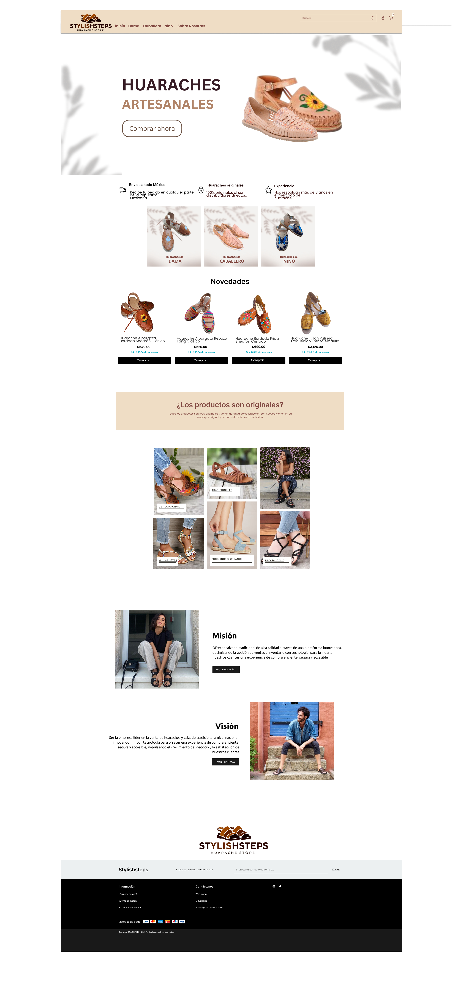
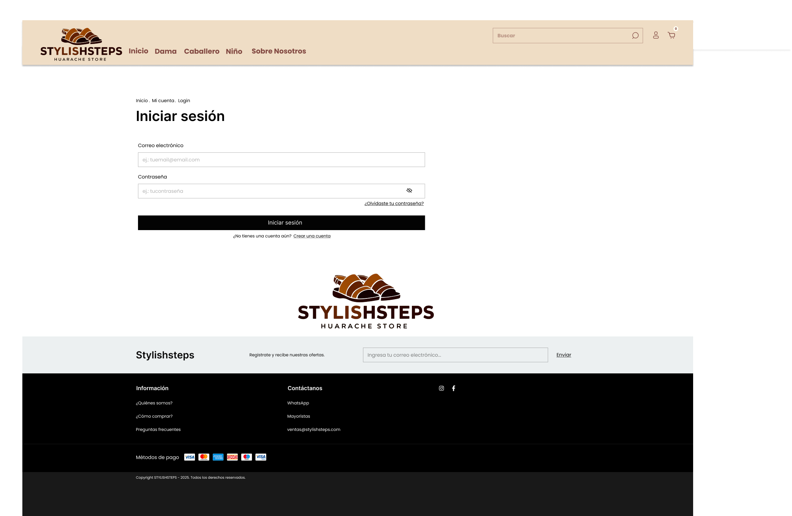

# Stylish Steps – Sistema de venta en línea de huaraches

`Proyecto en equipo` · Ingeniería de Software · Diseño de Interfaz

Proyecto para llevar a línea la venta de huaraches artesanales de una
productora local de Sahuayo, Michoacán, que hasta ahora vendía solo de forma
física. Incluye el análisis de requisitos, el diseño del sistema, la base de
datos, el plan de pruebas, la documentación y el prototipo del sitio web.
Instituto Tecnológico de Jiquilpan – Ingeniería en Sistemas Computacionales (2025)

## Funcionalidades del sistema
- Registro y autenticación de clientes
- Catálogo de productos con precio, descripción e imágenes
- Carrito de compras con verificación de disponibilidad
- Consulta de compras realizadas
- Pedidos, pago y aplicación de descuentos

## Contenido
- `requisitos/` – análisis de requerimientos, formato IEEE 830 y estudio de factibilidad
- `diseno/` – diagramas de flujo, de clases, de causa y efecto, arquitectura de capas y pantallas
- `base-de-datos/` – script SQL de la base de datos y documento de implementación
- `pruebas/` – diseño de casos de prueba y pruebas de componentes
- `documentacion/` – manual del sistema, documentación de usuario e informe técnico
- `sitio-web/` – prototipo del sitio web en HTML y CSS [https://dannage.github.io/stylish-steps/sitio-web/](https://dannage.github.io/stylish-steps/sitio-web/Index.html)

## Equipo
- Danna Geraldine Ávila García
- Isis Lizbeth Vázquez Ávalos
- Bryan Gael Esquivel Pérez

## Mi participación
Mi trabajo en el proyecto se centró en el **diseño**:
- Diseñé el boceto y el prototipo del sistema en Figma: inicio de sesión y página principal.
- Diseño de la interfaz del sitio web:inicio de sesión, página principal y pedidos.
- Diseño del sistema: flujo de procesos, arquitectura de capas o diagrama de clases.
- Maquetación del sitio en HTML y CSS. 

## Diseño de la interfaz

## Tecnologías y herramientas
UML · IEEE 830 · SQL · HTML5 · CSS3 · Diagramas de flujo y de arquitectura · Figma
